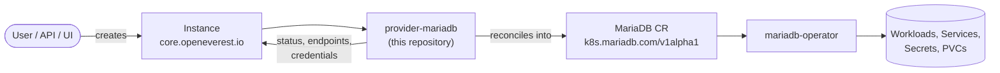

# MariaDB Provider

> [!WARNING]
> **Pre-alpha.** OpenEverest v2 and this provider are under active development. CRD schemas,
> chart values and defaults change frequently, including in breaking ways, and there is no
> supported upgrade path between versions yet. Not for production use.

<!-- Remove the pre-alpha banner and the status badge at v2 GA. -->

[](https://github.com/openeverest/openeverest)
[](https://github.com/openeverest/provider-mariadb/actions/workflows/ci.yaml)
[](https://github.com/openeverest/provider-mariadb/releases)
[](https://pkg.go.dev/github.com/openeverest/provider-mariadb)
[](LICENSE)

Run **MariaDB** on Kubernetes through [OpenEverest](https://github.com/openeverest/openeverest),
backed by the [`mariadb-operator`](https://github.com/mariadb-operator/mariadb-operator).

## What this is

OpenEverest providers translate a single, technology-agnostic `Instance` custom
resource into the native custom resources of an upstream Kubernetes operator —
for databases, but equally for caches, message queues, object storage, or
model-serving runtimes. This repository is the provider for **MariaDB**: it owns
the technology-specific knowledge — topologies, versions, parameters, backup
wiring — so that users, the API server, and the UI stay technology-agnostic.

> [!IMPORTANT]
> **This provider is not standalone.** It requires an OpenEverest installation
> (core CRDs and controller) in the cluster. Installing this chart on its own
> does nothing. See [Install OpenEverest](https://openeverest.io/documentation/current/quick-install.html).



The provider watches `Instance` resources whose `spec.providerRef.name` is
`mariadb`, and reports workload health back onto `Instance.status`. It never
manages pods directly — all lifecycle work is delegated to the operator.

## Compatibility

| provider-mariadb | OpenEverest | mariadb-operator | Kubernetes |
|---|---|---|---|
| `0.3.x` | `2.0.0-dev.5` | `26.10.x` | `1.30` – `1.34` |
| `0.2.x` | `>= 2.0.0` | `26.10.x` | `1.30` – `1.34` |
| `0.1.x` | `>= 2.0.0` | `26.6.x` (≤ 0.1.5), `26.10.x` (≥ 0.1.6) | `1.30` – `1.34` |

## Capabilities

What you can do to a running instance through the `Instance` API. Upgrading the
provider itself is covered under [Installation](#installation).

| Capability | Status | Notes |
|---|---|---|
| Provisioning | ✅ | |
| Horizontal scaling | ✅ | `spec.components.engine.replicas`; scaling out the `replication` topology requires a backup storage in `spec.backup`, used to stage the physical backup that seeds new replicas |
| Vertical scaling (CPU / memory) | ✅ | `spec.components.engine.resources` |
| Version upgrades | ✅ | of the deployed MariaDB version — change `spec.version`; see [Versions](#versions). Downgrades to an older major or minor version are rejected |
| High availability (Galera) | ✅ | `spec.topology.type: galera` — multi-master cluster; odd node count (default 3) |
| High availability (replication) | ✅ | `spec.topology.type: replication` — async primary/replica cluster; at least 2 nodes (default 3). With a backup storage in `spec.backup`, replicas that break are rebuilt automatically |
| Proxy / load balancing (MaxScale) | ✅ | opt-in via the `proxy` component on `galera` and `replication`; see [MaxScale proxy](#maxscale-proxy) |
| Custom configuration | ✅ | `my.cnf` via the engine component's `configuration` parameter |
| Monitoring | ✅ | opt-in via the `monitoring` component; deploys `mysqld-exporter` and a Prometheus `ServiceMonitor` — requires the `ServiceMonitor` CRD (`monitoring.coreos.com`) unless `serviceMonitor.enabled: false`. `victoriaMetrics.enabled` creates a `VMServiceScrape` instead — requires the `VMServiceScrape` CRD (`operator.victoriametrics.com`); the `ServiceMonitor` stays off unless `serviceMonitor.enabled` is set |
| Pod scheduling | ✅ | `spec.components.{engine,proxy}.schedulingPolicy` — `affinity` (`nodeAffinity` and `podAntiAffinity`; `podAffinity` is rejected), `nodeSelector`, `tolerations` and `topologySpreadConstraints`; `schedulerName` is not supported. A set `affinity` replaces the HA default soft anti-affinity, `{}` sets none |
| TLS | ✅ | enabled by default with operator-managed certificates; CA is published in the connection Secret |

Stateful workloads additionally report:

| Capability | Status | Notes |
|---|---|---|
| Persistent storage | ✅ | `spec.components.engine.storage.size` |
| Storage expansion | ✅ | when the StorageClass allows volume expansion; shrinking the volume or changing its StorageClass is rejected |
| Backups (on demand) | ✅ | logical (`mariadb-dump`) or physical (`mariadb-backup`) to S3-compatible storage; strategy selected via the backup `type` parameter |
| Backups (scheduled) | ✅ | cron schedules per storage via `spec.backup` |
| Restore | ✅ | logical backups are restored in place (same Instance only) or into a new Instance via `spec.dataSource`; physical backups are restored by seeding a new Instance from `spec.dataSource` |
| Point-in-time recovery | ✅ | binary log archival on the `replication` topology; one storage may enable `pitr`; recover a new `replication` Instance to a target time via `spec.dataSource` (`PointInTime`) |
| Start from a VolumeSnapshot | ✅ | `bootstrap.volumeSnapshot.name`: a new Instance from a snapshot of another instance's data volume, in seconds on copy-on-write storage; see [Start from a volume snapshot](#start-from-a-volume-snapshot) |

## Installation

The provider chart is published as an OCI artifact:

```bash
helm install provider-mariadb \
  oci://ghcr.io/openeverest/charts/provider-mariadb \
  --version 0.2.2 \
  --namespace everest-system
```

- The `mariadb-operator` (and its CRDs) is bundled as a chart dependency and is
  installed automatically.
- The chart registers an admission webhook, so an invalid `Instance` is rejected
  when it is written, with every error and its field path. Its serving certificate
  is generated by the chart and kept across upgrades; set
  `admission.certManager.enabled=true` to have cert-manager issue it, or supply one
  through `admission.certs`. If the provider is down, writes are admitted and the
  `Instance` reports the errors in its `Ready` condition. A missing object the
  `Instance` names, such as its user Secret, is never a reason to reject it:
  `kubectl` prints a warning, and the `Instance` reports it once created.

Upgrade and uninstall:

```bash
helm upgrade provider-mariadb oci://ghcr.io/openeverest/charts/provider-mariadb --version 0.2.2
helm uninstall provider-mariadb --namespace everest-system
```

Uninstalling the chart does **not** delete running `Instance` resources or their data.

## Usage

Verify that the provider registered itself:

```bash
kubectl get providers.core.openeverest.io mariadb
```

Create an instance:

```yaml
apiVersion: core.openeverest.io/v1alpha1
kind: Instance
metadata:
  name: my-instance
spec:
  providerRef:
    name: mariadb
  components:
    engine:
      type: mariadb
      replicas: 1
      resources:
        requests:
          cpu: 500m
          memory: 2G
      storage:
        size: 10Gi
```

Component names are defined by this provider — see
[definition/provider.yaml](definition/provider.yaml). `spec.version` and
`spec.topology` are optional; the provider defaults apply. More examples live in
[examples/](examples/).

Watch it come up and read the connection details:

```bash
kubectl get instance my-instance -w
kubectl get instance my-instance -o jsonpath='{.status.connectionSecretRef.name}'
```

The credentials (host, port, username, password, uri) live in the connection
Secret named by `.status.connectionSecretRef.name`.

The same Secret also carries an admin connection for tools that need
server-level privileges, such as migrations that set up replication:

| Key | Value |
| --- | --- |
| `admin-username`, `admin-password` | `root` and its password |
| `admin-host`, `admin-port` | the MariaDB Service (the primary Service for `galera` and `replication`), never MaxScale, which rejects `root` |
| `admin-tls`, `admin-ca.crt` | present when MariaDB has TLS enabled; the CA of the MariaDB server certificate |
| `admin-skip-replica-start` | `"true"` for `standalone` and `galera`: replication connections stay stopped when the server starts (see below) |

Applications should keep using `username`/`password`, which only have access
to the initial `everest` database. Anyone who can read the connection details
gets `root`.

`standalone` and `galera` servers run with `skip-slave-start`, appended after
the user's `configuration`. MariaDB does not persist a replication
connection's filters, so a connection started on boot would apply everything
its source writes, account changes included, before a tool such as a
migration could restore its filters. Neither topology uses replication
connections otherwise; the `replication` topology keeps the default, because
the operator does not restart replicas' replication after a Pod restart. A
replication connection you create yourself on these topologies must be
started again (`START SLAVE`) after a restart.

TLS is enabled by default. The same connection Secret contains `tls: "true"`
and the operator-generated CA bundle under `ca.crt`, allowing clients to verify
the MariaDB server certificate. Unencrypted connections remain accepted by
default for migration compatibility. To reject them, set:

```yaml
spec:
  components:
    engine:
      parameters:
        tls:
          required: true
```

TLS can be explicitly disabled with `tls.enabled: false`. Galera deployments
also encrypt state snapshot transfers by default; this can be changed with
`tls.galeraSSTEnabled`. See [examples/instance-tls.yaml](examples/instance-tls.yaml).

## MaxScale proxy

The `galera` and `replication` topologies can be fronted by
[MariaDB MaxScale](https://github.com/mariadb-operator/mariadb-operator/blob/main/docs/maxscale.md),
which routes writes to the primary and balances reads across nodes. Enable it
through the `proxy` component:

```yaml
spec:
  topology:
    type: replication
  components:
    proxy:
      replicas: 2        # default
      parameters:
        enabled: true
      service:
        serviceType: LoadBalancer
```

While the proxy is enabled, the connection Secret points at the MaxScale
Service (`<name>-maxscale`) with the same credentials. MaxScale terminates TLS
only when the engine requires it (`tls.required: true`); the connection Secret
then carries the MaxScale CA. Setting `enabled: false` removes MaxScale. See
[examples/instance-maxscale.yaml](examples/instance-maxscale.yaml).

Primary failover, rejoin and `read_only` stay with the operator: MaxScale only
routes traffic and follows the topology. With `replication`, the provider turns
off MaxScale's own `auto_failover`, `auto_rejoin` and
`switchover_on_low_disk_space`, because running failover in both MaxScale and
the operator races and can leave no writable primary
([#37](https://github.com/openeverest/provider-mariadb/issues/37)).
Replication nodes also boot read-only, so a restarted former primary never
accepts writes before the operator has demoted it.

> [!IMPORTANT]
> MaxScale is licensed under the
> [Business Source License](https://github.com/mariadb-corporation/MaxScale/blob/23.08/LICENSE.TXT).
> Make sure you understand the implications before enabling it.

## Backups and restore

Backups are driven natively by the operator to an S3-compatible object store —
the provider never runs side-car Jobs. Two strategies are available, selected
per backup via the `type` parameter:

- **`logical`** — a `mariadb-dump` SQL dump, restored in place (from a backup of
  the same Instance) or by seeding a new Instance from `spec.dataSource`.
- **`physical`** — a `mariadb-backup` data-directory snapshot, restored by
  seeding a new Instance from `spec.dataSource` (in-place restore is not
  supported by the engine for physical backups).

Point-in-time recovery builds on physical backups plus binary log archival; see
[Point-in-time recovery](#point-in-time-recovery) below.

Enable backups on the Instance by registering a `BackupStorage` (a reference to
your object store) under `spec.backup`, using the provider's `mariadb`
`BackupClass`. Cron `schedules` are configured per storage:

```yaml
spec:
  backup:
    enabled: true
    classRef:
      name: mariadb
    storages:
      - storageRef:
          name: my-s3-storage
        schedules:
          - name: daily
            enabled: true
            cron: "0 0 * * *"
            retention:
              type: count   # or `type: time` with `duration: 30d` (d/w/m)
              count: 7
            parameters:
              type: physical
              compression: gzip
```

On-demand backups are taken by creating a `Backup` resource that targets the
same storage and class. Restore a new Instance from an existing backup (logical
or physical) with `spec.dataSource`:

```yaml
spec:
  dataSource:
    type: Backup
    backup:
      backupRef:
        name: my-backup
```

`spec.dataSource` is immutable once set and requires `spec.backup.enabled: true`
with at least one storage so the provider can read the source backup. The new
Instance reuses the source Instance's credentials, because the backup carries
its users. It reports the `Restoring` phase until the data is in place: physical
backups are restored before MariaDB starts, while logical backups are replayed
once the new cluster is up.

### Point-in-time recovery

Point-in-time recovery (PITR) continuously archives the primary's binary logs to
object storage on top of a full physical base backup, so an Instance can be
recovered to any moment within the retained window. Binary log archival is only
supported on the **`replication`** topology (Galera and standalone are not
supported by the engine yet).

Enable it by setting `pitr.enabled` on exactly one storage that also declares a
physical backup schedule (which drives the base backup); the provider reconciles
a `PointInTimeRecovery` object and turns on archival:

```yaml
spec:
  topology:
    type: replication
  backup:
    enabled: true
    classRef:
      name: mariadb
    storages:
      - storageRef:
          name: my-s3-storage
        pitr:
          enabled: true
        schedules:
          - name: base
            enabled: true
            cron: "0 * * * *"
            parameters:
              type: physical
```

The recovery window is published on `status.backup.storages[].pitr`. Recover a
new Instance to a target time (or the latest archived point) via
`spec.dataSource`:

```yaml
spec:
  dataSource:
    type: PointInTime
    pointInTime:
      source:
        instanceRef:
          name: my-source-instance
        storageRef:
          name: my-s3-storage
      recoveryTarget: date   # or "latest"
      date: 2026-02-20T18:00:04Z
  topology:
    type: replication
```

The recovered Instance must use the `replication` topology: the engine only
replays binary logs on replication clusters. The Instance reports `Restoring`
until the binary logs are replayed up to the target, and `Failed` if the replay
fails.

### Start from a volume snapshot

`bootstrap.volumeSnapshot.name` starts a new Instance from a VolumeSnapshot of
another instance's data volume, in the same namespace, instead of an empty
database. The operator creates every node's volume from the snapshot
(`bootstrapFrom.volumeSnapshotRef`) and InnoDB recovers it as after a crash, so
a snapshot of a running node is enough. On storage whose snapshots are
copy-on-write clones, such as OpenEBS ZFS LocalPV, it's ready in under a minute
whatever the size; the Branching plugin uses it to make instance branches.

```yaml
spec:
  topology:
    type: standalone
  components:
    engine:
      type: mariadb
      storage:
        size: 20Gi                  # the snapshot's size: some drivers can't resize clones
        storageClass: openebs-zfspv
      parameters:
        bootstrap:
          volumeSnapshot:
            name: orders-snapshot-1   # annotated bootstrap-instance: <this instance>
```

- The snapshot must be annotated
  `provider-mariadb.openeverest.io/bootstrap-instance: <instance name>`.
  Everest checks that a user may read an Instance's `spec.dataSource`, not its
  engine parameters: the annotation, which Everest users can't set, is what
  lets an Instance start from a snapshot. Without it the Instance is admitted
  with a warning and reports the error, and nothing is created.
- The data carries the source's users. The operator sets the new Instance's
  own password on its user (`everest`). Root's password is in the data too:
  the new Instance starts with the source's root password, copied from the
  instance whose volume was snapshotted, then the provider replaces it with
  a new one. A standalone node restarts once for that (its probes use the
  password it started with); the Instance stays `Provisioning` until it runs
  with the new password, so its connection details never carry the source's.
- The snapshot is only read at creation and can't be changed afterwards, nor
  combined with `spec.dataSource`.
- A snapshot of a replication replica carries its replication settings:
  reset them (`RESET REPLICA ALL`) on a standalone Instance made from it.

## Topologies

<!-- BEGIN GENERATED: topologies -->
| Topology | Default | Description |
|---|---|---|
| `standalone` | ✅ | Single MariaDB instance (no replication or Galera) |
| `galera` | | Multi-master Galera cluster for high availability (odd number of nodes, default 3) |
| `replication` | | Async primary/replica cluster for high availability (at least 2 nodes, default 3) |
<!-- END GENERATED: topologies -->

## Versions

<!-- BEGIN GENERATED: versions -->
| Version bundle | Default | mariadb |
|---|---|---|
| `10.11` | | `10.11` |
| `11.4` | | `11.4` |
| `11.8` | | `11.8` |
| `12.3` | ✅ | `12.3` |
<!-- END GENERATED: versions -->

Source of truth: [definition/versions.yaml](definition/versions.yaml).

## Configuration

- **Chart values:** [charts/provider-mariadb/values.yaml](charts/provider-mariadb/values.yaml)
- **Instance parameters:** per-component and per-topology `parameters` schemas,
  defined under [definition/](definition/) and published on the `Provider`
  resource (`kubectl get provider mariadb -o yaml`). The provider rejects an
  Instance that does not match them, and the UI checks the form against them as
  you type.

The main technology-specific knob is the engine's `configuration` parameter,
which is passed through to the MariaDB server as `my.cnf`.

## Development

Requires Go (see [go.mod](go.mod)), Docker, Helm, kubectl, and a Kubernetes
cluster you can reach. For local development we recommend [k3d](https://k3d.io) —
`make dev-up` creates the cluster for you.

```bash
make dev-up             # local k3d cluster + Tilt dev environment
make generate           # RBAC, provider spec, Helm chart sync
make run                # run the provider locally against the cluster
make test-unit
make test-integration   # chainsaw suites under test/integration/
make dev-down
```

To work against a cluster you already have — kind, GKE, a shared dev cluster —
skip `make dev-up` and point Tilt at it:

```bash
cp dev/.env.example dev/.env   # set K8S_CONTEXT, and DOCKER_REGISTRY_URL for a remote registry
tilt up -f dev/Tiltfile
```

`make help` lists every target. `make verify` fails when generated files are
stale — run `make generate` and commit the result.

The provider contract (`Validate` / `Sync` / `Status` / `Cleanup`), RBAC
markers, watches, code generation, and the backup/restore interfaces are
documented once for all providers in [PROVIDER_DEVELOPMENT.md](https://github.com/openeverest/provider-sdk/blob/main/PROVIDER_DEVELOPMENT.md).

### Layout

| Path | Purpose |
|---|---|
| `cmd/provider/` | Entry point |
| `internal/provider/` | `ProviderInterface` implementation, RBAC markers |
| `internal/common/` | Component name constants |
| `definition/` | Provider identity, component types, versions, topologies |
| `charts/provider-mariadb/` | Helm chart (`generated/` is produced by `make generate`) |
| `config/rbac/role.yaml` | Generated `ClusterRole` — do not edit |
| `test/integration/` | Chainsaw suites |
| `test/vars.sh` | Pinned operator and workload versions used by tests |
| `examples/` | Example `Instance` resources |
| `dev/` | Tilt dev environment, `.env` configuration, k3d cluster config |
| `.github/workflows/` | CI: lint, build, unit and integration tests, release |

### Testing

- **Unit tests** — `make test-unit`.
- **Integration tests** — chainsaw suites under [test/integration/](test/integration/).
  The `core/` suite provisions an instance and verifies connectivity end to end.
- **CI** — [.github/workflows/ci.yaml](.github/workflows/ci.yaml) runs lint,
  build, unit tests, generated-file verification, Helm lint, and each
  integration suite on every pull request.

## Troubleshooting

```bash
kubectl logs -n everest-system deploy/provider-mariadb -f
```

| Symptom | Where to look |
|---|---|
| `Instance` stuck in `Creating` | `kubectl describe instance <name>` conditions, then the provider logs |
| No `Provider` resource in the cluster | Is the chart installed? Check the provider deployment logs |
| `Instance` ignored entirely | `spec.providerRef.name` must be `mariadb` |
| MariaDB resource created but no pods | Inspect the `MariaDB` custom resource status — the failure is upstream in the operator |

## Contributing

Issues and pull requests are welcome. See
[PROVIDER_DEVELOPMENT.md](https://github.com/openeverest/provider-sdk/blob/main/PROVIDER_DEVELOPMENT.md)
and the [OpenEverest Code of Conduct](https://github.com/openeverest/openeverest/blob/main/CODE_OF_CONDUCT.md).

## Security

Report vulnerabilities per the [OpenEverest security policy](https://github.com/openeverest/openeverest/blob/main/SECURITY.md).
Please do not open public issues for security reports.

## License

Apache License 2.0 — see [LICENSE](LICENSE) for details.
